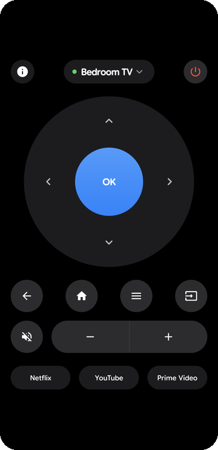
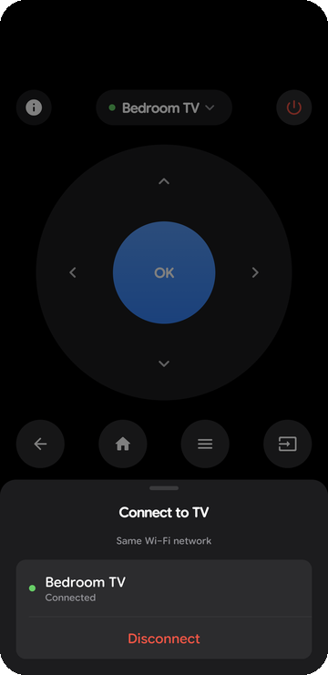
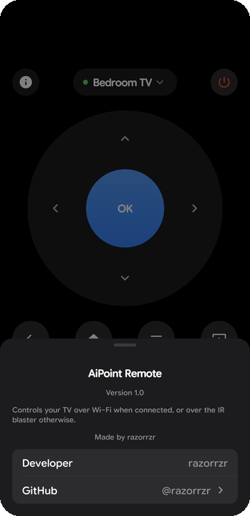

<div align="center">


# AIPONT · Realme SmartTV Remote

**A clean, minimal remote for Realme and Android TVs — over IR or Wi‑Fi.**

[](#install)
[](#build)
[](LICENSE)
[](https://github.com/RAZORRZR0/AIPONT-Realme-SmartTV-Remote/releases/latest)

&nbsp;&nbsp;
&nbsp;&nbsp;


</div>

## Features

- **IR blaster** — works instantly, no pairing, no network.
- **Wi‑Fi** — pairs with any Android TV / Google TV using the on‑screen PIN, then takes over automatically.
- **Phone volume keys** control the TV volume while the app is open.
- Circular D‑pad, haptics, dark Apple‑style design, 1.3 MB APK, no ads, no tracking.

## Install

Grab `AiPoint.apk` from the [latest release](https://github.com/RAZORRZR0/AIPONT-Realme-SmartTV-Remote/releases/latest) and open it on your phone.

| Mode | Needs |
|---|---|
| IR | A phone with an IR blaster (e.g. Xiaomi, POCO, Redmi) |
| Wi‑Fi | Phone and TV on the same network |

## How it works

- **IR:** NEC protocol at 38 kHz (address `0x40`) via `ConsumerIrManager`.
- **Wi‑Fi:** Android TV Remote protocol v2 — mDNS discovery (`_androidtvremote2._tcp`), TLS pairing on port 6467, commands on 6466.

## Build

```bash
git clone https://github.com/RAZORRZR0/AIPONT-Realme-SmartTV-Remote.git
cd AIPONT-Realme-SmartTV-Remote
./gradlew assembleRelease
```

Requires JDK 17+ and the Android SDK.

## License

[GPL-3.0](LICENSE) © razorrzr
